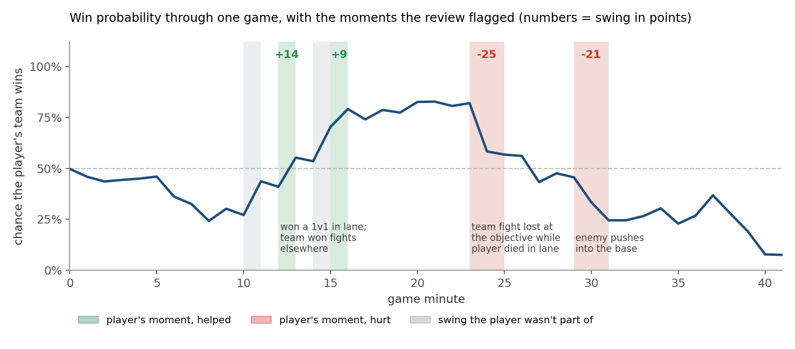
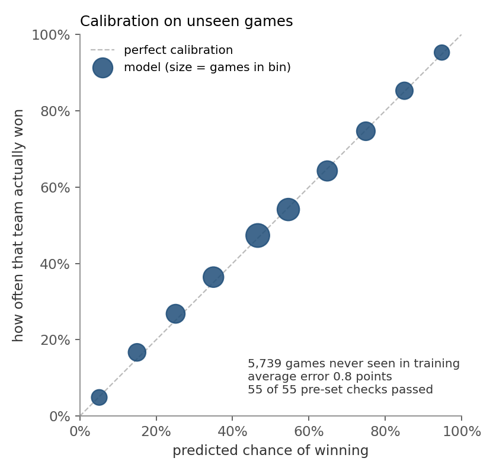
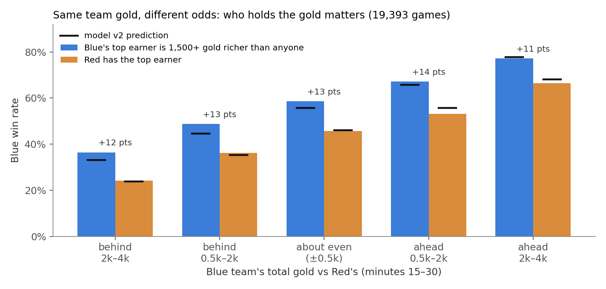
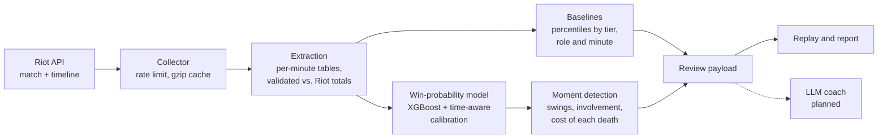

# lol-game-review

Automated, data-driven game review for League of Legends, in the spirit of chess.com's game
review. Given a match, it estimates each team's chance of winning at every minute, finds the
moments that moved that chance the most, and separates what the reviewed player did from what
happened elsewhere on the map.

Built in Python on Riot Games' public developer API: a data pipeline, a calibrated
gradient-boosted model trained on about 19,000 ranked matches, and a rules-based review engine.



*One of the author's games. The line is the model's estimate that the player's team wins.
Shaded bands are the moments the review flagged; the number is how many percentage points that
moment moved the estimate.*

> **New to League of Legends?** It's a 5v5 online strategy game. Matches last 25 to 40 minutes.
> Teams earn gold by defeating opponents and computer-controlled units, spend it on items, and
> win by destroying the enemy base. Each player has a role (top, jungle, mid, bottom, support).
> Ranked matches are grouped by skill tier; this project uses two upper-middle tiers, Emerald
> and Diamond.

## Highlights

- **About 20,000 matches, validated against the source.** A rate-limited, resumable API
  collector with a compressed on-disk cache. It turns raw match timelines into about 600,000
  minute-by-minute game states. Every extracted game is checked against Riot's official
  end-of-game summary: core player stats and team objectives match exactly, team kills in
  99.8% of games.
- **A win-probability model that's calibrated, not just accurate.** XGBoost with monotonic
  constraints and a time-aware calibration layer. When it says a team has a 70% chance, that
  team wins about 70% of the time: average error 0.8 points on 5,739 matches it never saw.
- **Pass/fail criteria set before training.** The release check (calibration limits overall,
  by game phase, skill tier and patch) was written down before any model was trained, and a
  fresh holdout is evaluated exactly once.
- **Hypothesis-driven feature work.** A player's hunch, "a lead held by one strong player is
  worth more than the same lead spread evenly", was measured (worth 11–14 percentage points),
  added as features, and confirmed out of sample. A related idea (experience distribution) was
  tested the same way and rejected because it added nothing.
- **A review engine that doesn't blame the player for the team.** Flagged moments are split
  into the player's own (kills, deaths, assists, objectives) and swings they weren't part of.
  Each death is costed: time dead (from respawn timers measured on about 360,000 observations),
  resources lost against the lane opponent, and objectives lost meanwhile.

## Results

### Win-probability model

Test split of 2,831 matches, never used for training or tuning. Log loss measures the quality
of the probabilities (lower is better); 0.693 is what always answering "50%" scores.

| Model | Log loss | Brier | Calibration error |
|---|---|---|---|
| Logistic regression on gold difference (baseline) | 0.5712 | 0.1961 | 1.53 pts |
| Neural network (64-32) | 0.5525 | 0.1885 | 1.71 pts |
| XGBoost, original 29 features (v1) | 0.5549 | 0.1894 | 1.99 pts |
| XGBoost, 37 features (v2) | 0.5521 | 0.1883 | 1.95 pts |
| **XGBoost v2 + time-aware calibration** | **0.5512** | **0.1881** | **1.59 pts** |

- **Accuracy rises through the game.** The team the model favours goes on to win 54% of the
  time at minute 2, 67% at minute 10 and 80% at minute 25. Early on, the outcome is mostly
  undecided, so a calibrated model should be unsure.
- **The neural network and the trees perform the same** (difference within 0.001). A 9-setting
  regularisation search moved validation loss by less than 0.001. The model is at the limit of
  its inputs, not overfitting.
- **Late-game overconfidence was found and fixed.** The raw model was overconfident by up to 4
  points late in games. The calibration layer is a smooth function of game time, so it adds no
  artificial jumps at phase boundaries. It still lets the curve swing hard on decisive late-game
  events.

<p align="center">
  
</p>

*Release check on 5,739 matches from a newer game patch and from players not in the training
data. Each point groups predictions of similar confidence: predicted chance on the x-axis,
actual win rate on the y-axis.*

### Finding: who holds the gold matters, not just how much



The first model only saw team totals, so it treated a 3,000-gold lead held by one player the
same as one spread across five. Across 19,393 games, at the same team gold, the side with the
single richest player wins 11–14 points more often. Five per-role gold differences plus two
gold-concentration features closed most of that gap (black marks). The remaining 3–4-point
shortfall is recorded as a known limitation.

## Sample output

`scripts/moments.py` prints the review and writes an interactive HTML replay (minimap, gold and
win-probability charts, and the flagged moments) plus a JSON payload for the coaching step.
Excerpt from the game in the chart above:

```text
Aatrox (TOP, Name#TAG) — loss
Moments to review: 4 (shown: ≥ 75th percentile swing for that point in the game, ≥ 5 pts)
  #4 · 15:00–16:00 · moderate · +9 pts
      Top lane: you killed Nasus
  #1 · 23:00–25:00 · notable · -25 pts · 3 things at once
      Dragon pit: 5v4 teamfight, your team lost 2–4; enemy took Ocean Drake (you: credited with an assist on Miss Fortune)
      Top lane: enemy took your top inner tower (you were nearby, not credited)
      Top lane: you died to Nasus
      dead 48s; back in play by 25:00; vs Nasus meanwhile: CS -7, XP -1,162; lost meanwhile: Ocean Drake · you were in base buying at 23:58
      note: 3 separate things happened between the same minute snapshots; the swing is their combined effect and can't be split
      note: nearby, not credited: you were close (minute snapshots) but not listed in the kill/objective
Game swings you weren't part of (context, not about you):
  context · 14:00–15:00 · notable · +17 pts · 4 things at once
      Mid lane: enemy took your mid outer tower (you weren't there)
      Bot lane: your team took their bot outer tower (you weren't there)
      ...
```

A moment is flagged only when its swing is unusually large *for that point in the game*
(75th percentile or above among swings of the same length at the same minute, across the
corpus) and at least 5 points. Late-game swings are naturally bigger, so a fixed threshold would
flag mostly late moments.

## How it works



Two models, each doing the one thing code can't:

1. **Win probability** is learned from outcomes, because "chance of winning from this state"
   only exists as a pattern across thousands of games.
2. **Coaching text** (planned) will come from a prompted language model that writes from a
   structured payload of facts. It won't judge the game itself.

Everything else is deterministic, testable code: extraction, baselines (group-by aggregates),
event clustering, map regions and respawn timers measured from the data.

### Design principles

- **Comparative, not absolute.** Chess engines can prove the best move; League has hidden
  information and no enumerable move list. The review says how much a moment moved the odds and
  how that compares with similar situations. It never claims a play was objectively right or
  wrong.
- **Calibration blocks release.** Every severity label depends on the probabilities, so one
  confident misjudgment on a play the user knows was fine destroys trust. The model ships only
  after the fixed checks pass on fresh data.
- **Effective sample size is games, not rows.** The minutes of one match share one outcome, so
  every check is sized and resampled by game, with its noise level reported next to its result.
- **Hindsight bias is the main product risk.** Reviews mark involvement explicitly ("you weren't
  there", "nearby, not credited") and show what the game data credited, so the player can check
  it.

## Status

| Phase | Status | |
|---|---|---|
| 0. Data contract | Done | Field mapping and known gaps: [`docs/extraction-contract.md`](docs/extraction-contract.md) |
| 1. Data collection | Done | 12,000 Emerald + 2,000 Diamond ranked matches, plus a 5,885-match fresh holdout |
| 2. Replay viewer | Done | Self-contained interactive HTML replay of any match |
| 3. Extraction | Done | 2.1M player-minute rows, validated against Riot's end-of-game summary |
| 4. Baselines | Done | Percentile of each stat vs. the same tier, role and minute |
| 5. Win probability | v1 released; v2 pending release | v2 passed development checks; its release check runs once on the next patch's fresh data |
| 6. Moment detection | Built, in validation | Spec with pre-set pass criteria: [`docs/phase6-spec.md`](docs/phase6-spec.md) |
| 7–10 | Planned | What the player did, what they could see, comparison with stronger players, coaching text |

Full plan: [`docs/v1-plan.md`](docs/v1-plan.md). Design decisions:
[`docs/decisions.md`](docs/decisions.md). Data pitfalls: [`docs/riot-gotchas.md`](docs/riot-gotchas.md).

## Getting started

```bash
python -m venv venv
source venv/bin/activate            # Windows: venv\Scripts\activate
pip install -e ".[dev]"
cp .env.example .env                # add a Riot API key
pytest                              # 130+ offline tests; no key or data needed
```

Development keys come from https://developer.riotgames.com and expire every 24 hours.

### Review one of your games

```bash
python scripts/moments.py --riot-id "Name#TAG"        # latest ranked game; --back N for older ones
python scripts/replay.py  --riot-id "Name#TAG"        # interactive replay only
python scripts/report.py  --riot-id "Name#TAG"        # stat percentiles vs. your tier
```

`--platform` selects another server (e.g. `euw1`, `kr`, `tw2`) and `--queue` another queue
(`draft`, `flex`, ...). The model is trained on NA ranked solo/duo, so other servers and queues
are flagged in the output.

### Rebuild the data and model

```bash
# Collect (resumable; safe to stop and restart)
python scripts/collect_summoners.py --tier EMERALD --target 1000
python scripts/collect_matches.py   --tier emerald --target 5000

# Extract per-minute tables (~2 minutes, no API key)
python scripts/extract.py --tier all

# Baselines, then the win-probability model and its calibration report
python scripts/build_baselines.py --tier all
python scripts/build_winprob_dataset.py
python scripts/train_winprob.py

# Release check on a fresh set (new players, newest patch; run once per set)
python scripts/check_holdout.py --name <fresh_corpus_name>
```

## Repository layout

```
src/lolreview/
  riot/        API client, routing, rate limiter, gzip cache, static game data
  extract/     timelines -> per-player and per-team minute tables, event table
  baselines/   tier x role x minute percentiles
  model/       dataset, training, calibration, release checks, prediction
  review/      moment detection, involvement, death cost, respawn timers
  viz/         HTML replay viewer
  rift.py      map geometry (structures, objectives, regions), measured from the data
scripts/       command-line entry points
tests/         offline tests with synthetic games
docs/          plan, data contract, phase specs and validation logs
```

**Stack:** Python, pandas, PyArrow/Parquet, NumPy, XGBoost, scikit-learn, Matplotlib, pytest.

---

*lol-game-review isn't endorsed by Riot Games and doesn't reflect the views or opinions of
Riot Games or anyone officially involved in producing or managing Riot Games properties.
Riot Games, and all associated properties are trademarks or registered trademarks of Riot
Games, Inc.*
